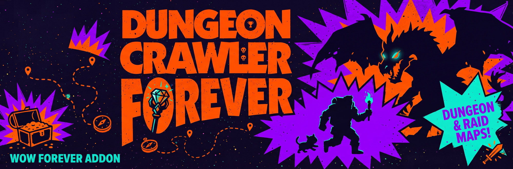

# Dungeon Crawler Forever

Dungeon highscores, maps and a journal for **World of Warcraft: Forever**. Open the world map inside a dungeon (or click a dungeon entrance on a
zone map) to see the dungeon's map with its floors and clickable bosses. Uses the game's own map art wherever possible,
so the addon stays small.

Source and issues: https://github.com/perweum/dungeon-crawler-forever

## What it does

- **Highscore.** Every dungeon run is timed from the first fight to the last boss of the dungeon's route, and the **Highscore** tab ranks runs for each level bracket: click a row for the group, the time at every boss, deaths and wipes. Your own best is always shown with its true rank. Finished runs are shared with your group, guild and friends who have the addon (you choose who, or turn it off with `/dm sharing`), so the boards fill up.
- **Journal, maps and routes.** A card for every dungeon and raid, clean floor maps, entrance pins on the world map, and suggested routes for 23 dungeons, and you can draw several routes of your own for any dungeon.
- **Bosses, loot and quests.** Loot with drop chances, abilities, and dungeon quests with your progress.
- **Controller support.** The journal and the dungeon map work with a gamepad (see below).

Status: in active development. See `CONTRIBUTING.md` to help, `data/SOURCES.md` for the data sources and licences.

## Controller support

Works with the game's gamepad UI (Xbox and PlayStation controllers; the button icons follow your controller).

- **Journal:** open it and the D-pad moves between the cards and tabs; **A** opens a card, **B** goes back.
- **Dungeon map:** the **left stick** moves a crosshair, the **right stick** zooms where it points, and pushing the crosshair into the edge of a zoomed map scrolls it. **D-pad Left / Right** switch between the map and the sidebar; in the sidebar **D-pad Up / Down** choose and **A** selects a boss, floor, loot item or quest. **X** hides or shows the sidebar. **B** goes back to where the dungeon was opened from. The game's own **D-pad Down / Up** still switch between the small and the full map.
- **Entrances:** on the world map, put the game's cursor on a dungeon entrance and press **A**.
- A key guide at the bottom shows what each button does right now.
- Controller navigation pauses in combat and while you type.

**Opening it from a controller button.** Type `/dm macros` once. It creates the macros **DM Map**, **DM Journal** and **DM World Map** (`/click DungeonMapOpenMap LeftButton 1` and so on); put them on your controller layout in the game's settings. Use these rather than `/dm` or `/dm list` in your own macros: a typed command opens the map from addon code, and the game then blocks some controller actions (radial menu, chat) after the map closes. `/dm keys` and **Set key** also accept a controller button. The map's own button and radial menu work as usual.

## Licence
Code: GPL-3.0-or-later (see `LICENSE`). Map art credited below is not covered by this licence; it remains the work of its author.

## Credits
- Map art for **The Hall of Thanes** and **Excavation Site: Wetlands**: Santiago Reyes, *Atlas de Azeroth: Forever*
  (low-resolution copies, offered free to the community by the author). https://asguevara433.wixsite.com/srmaps
  The author sells high-resolution versions and accepts donations on his site; please consider supporting his work.
- Dungeon art, boss data and portraits come from the game client and public game-data tables; see `data/SOURCES.md`.
- Boss position data for a few bosses derived from the CMaNGOS classic database (GPL-3.0).

World of Warcraft and Blizzard Entertainment are trademarks of Blizzard Entertainment. This project is not affiliated with Blizzard.
